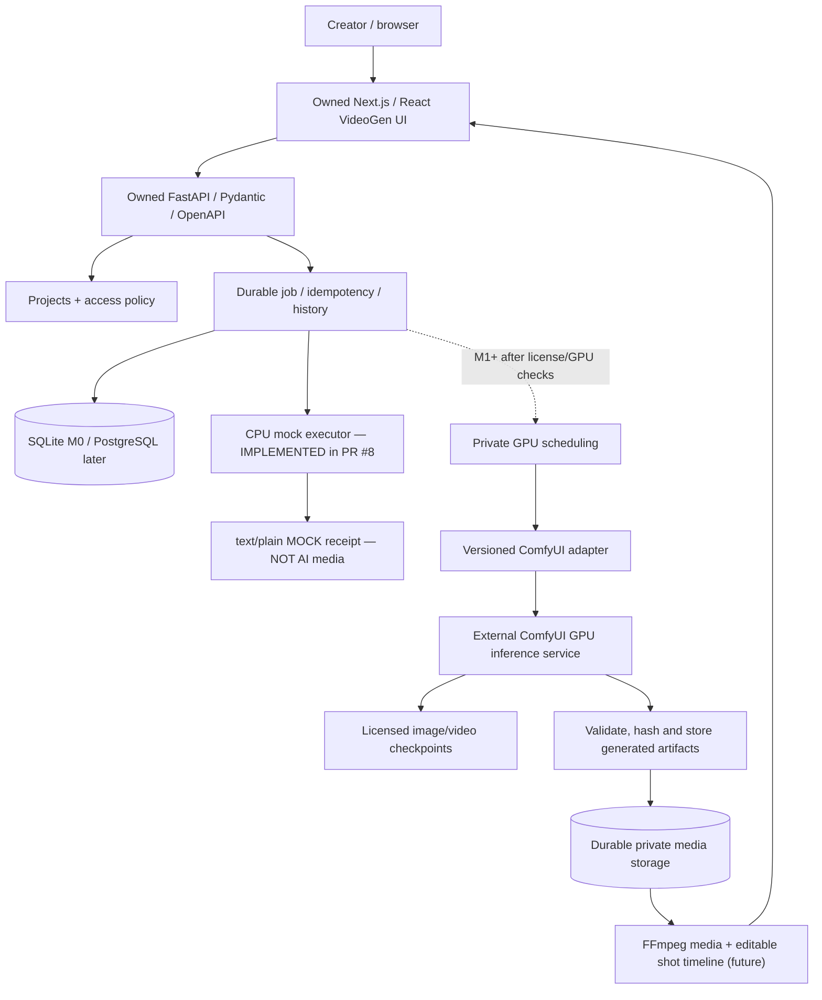
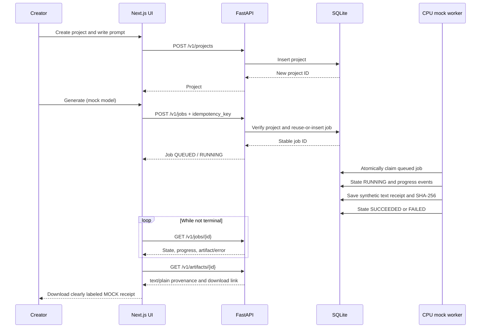
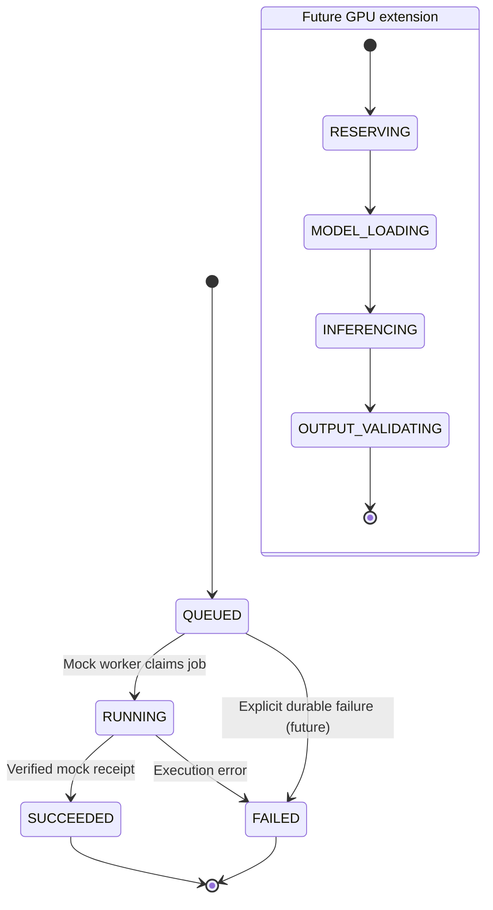
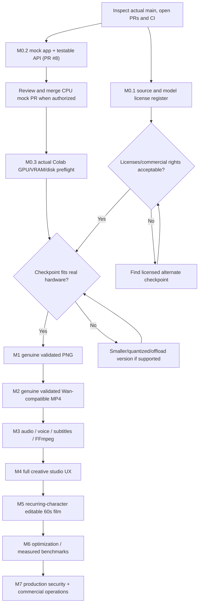
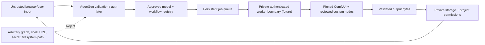
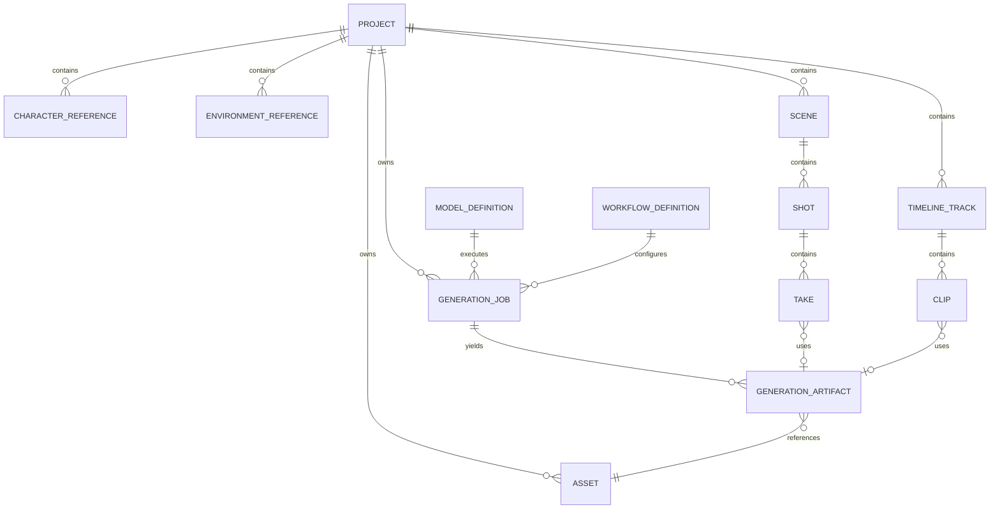
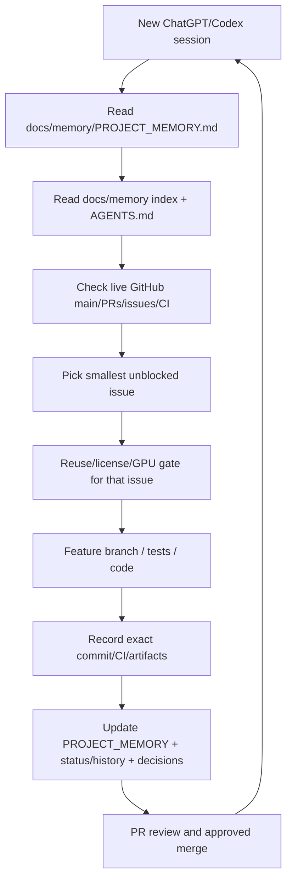

# VideoGen — editable architecture and process charts

**Format:** GitHub-native Mermaid diagrams (text in version control). These represent **planned boundaries** unless specifically identified as PR #8 implemented. Rendering requires a Mermaid-compatible GitHub Markdown viewer; all diagrams are also explained in captions so agents can read their text.

## Chart 1 — Product architecture (target; M0 highlighted)

**Explanation:** The browser never runs arbitrary ComfyUI workflows or owns private engine tokens. At M0 the API and mock worker use SQLite and a text artifact. Future real inference is **inside a separate private boundary**, not an exposed Colab service.

## Chart 2 — CPU mock job sequence (implemented in PR #8)

**M0 guards:** same idempotency key/payload returns same job; conflicting payload returns 409. Invalid model or missing project rejected. Failure recorded; no GPU execution, paid calls or "AI image" preview.

## Chart 3 — Job state transitions by milestone

**Future-only extension:** use typed terminal states for timeout/cancel/lost worker and isolated retries; never claim M0 cancellation or reliable distributed exactly-once semantics.

## Chart 4 — Human-approved movie/character continuity pipeline

```mermaid
flowchart LR
    SCRIPT["Concept + versioned script"] --> DIRECTOR["AI director proposes shots"]
    DIRECTOR --> APPROVAL{"Human approves?"}
    APPROVAL -- No --> SCRIPT
    APPROVAL -- Yes --> BIBLE["Character + environment bibles"]
    BIBLE --> SHOTS["Scene graph -> versioned shots"]
    SHOTS --> KEYFRAME["Approved appearance + references"]
    KEYFRAME --> GENERATE["Licensed model generates short takes"]
    GENERATE --> QA{"Continuity / quality QA"}
    QA -- "Rejected take" --> RETAKE["Reshoot only the affected shot"]
    RETAKE --> GENERATE
    QA -- "Approved" --> TIMELINE["Editable timeline / clips / audio / subtitles"]
    TIMELINE --> RENDER["FFmpeg assemble and render"]
    RENDER --> CHECK["Decodability / sync / hashes / provenance"]
    CHECK --> MOVIE["60s measured proof -> eventually full episode/movie"]
```

**Core differentiation:** character IDs, reference versions, wardrobe/voice/environment continuity and approved-take history. Reusing a seed/prompt alone does not guarantee identity. Full movies are **shot assemblies**, not one huge model call.

## Chart 5 — Dependency-ordered work graph

**Important:** M0.2 and license study can happen concurrently; genuine M1 cannot start until both licensing and actual GPU fit are known.

## Chart 6 — Threat, trust and deployment boundaries

**M0 security warning:** API has **no login, tenant isolation, public rate limit or quota**. CORS is not authentication. Bind only 127.0.0.1; never deploy M0 directly on the public internet or tunnel a Colab instance to serve strangers.

## Chart 7 — Domain relationships for movie system (target model)

**Scope:** only project, job, mock artifact, events and lightweight model/workflow contracts are currently in PR #8. Character/scene/clip entities are future milestones.

## Chart 8 — Source-of-truth continuity workflow

**Maintenance rule:** diagrams describe *intended* architecture, not proof it exists; edit their captions and state ledger whenever a milestone changes. Avoid diagrams that promise automatic production inference before corresponding tests.
